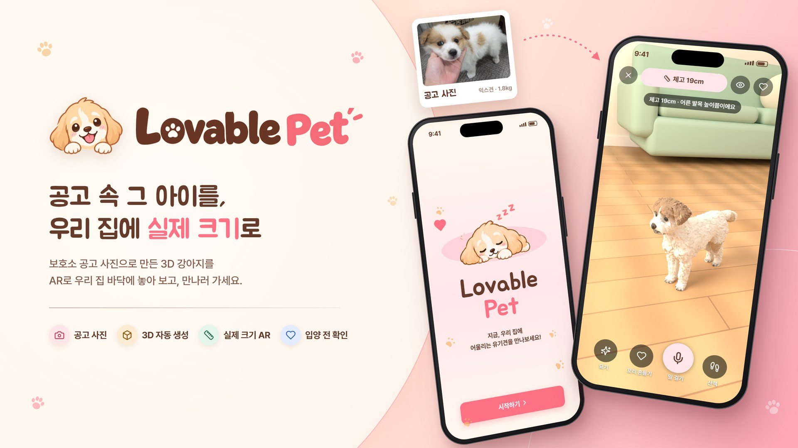
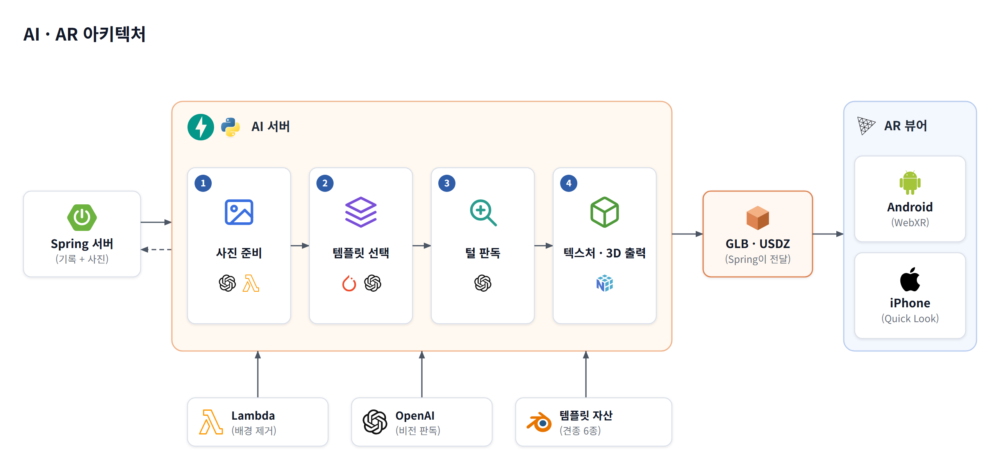
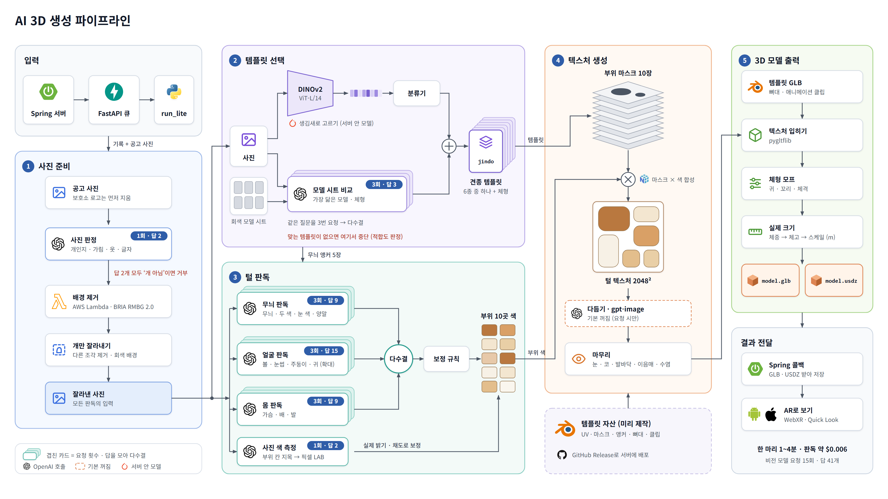

<div align="center">



<br>

**보호소 강아지를 입양 전에 우리 집에 띄워, 실제 크기로 함께 지내는 모습을 미리 체험해 보는 AR 서비스**

Lovable Pet의 **AI 3D 생성 파이프라인** 저장소입니다.

<br>


</div>

<br>

## 🐾 하는 일

- 보호소 공고 사진과 기록(품종 · 체중 · 털색)을 받아, 그 개를 닮은 3D 강아지(GLB, 아이폰 AR용 USDZ)를 만듭니다.
- 뼈대와 애니메이션이 들어 있는 견종 템플릿(6종)에 사진에서 읽은 털색 · 무늬를 입히고, 공고 체중으로 실제 크기를 맞춥니다.
- Spring 서버가 HTTP로 작업을 맡기고, 끝나면 콜백으로 결과를 받습니다.

<br>

## 🏗️ 아키텍처



<br>

## 🧪 3D 생성 파이프라인



<br>

## 📡 API

Spring 연동 계약은 [docs/API.md](docs/API.md), 애니메이션 클립과 재생은 [docs/ANIMATION.md](docs/ANIMATION.md)에 있습니다.

| 메서드 | 경로 | 설명 |
| :-- | :-- | :-- |
| `POST` | `/v1/fit` | 만들어도 되는 개인지 먼저 확인 (맞는 템플릿, 실제 크기) |
| `POST` | `/v1/jobs` | 3D 모델 생성 등록 (끝나면 콜백) |
| `GET` | `/v1/jobs/{job_id}` | 상태 · 결과 |
| `GET` | `/v1/jobs/{job_id}/files/model.glb` | 만든 모델 (GLB) |
| `GET` | `/v1/jobs/{job_id}/files/model.usdz` | 아이폰 AR용 모델 (USDZ) |
| `DELETE` | `/v1/jobs/{job_id}` | 끝난 작업의 파일 삭제 |
| `GET` | `/health` | 서버 상태 |

<br>

## 📁 폴더 구조

```
api/              파이프라인 (기본 lite: api/lite.py), HTTP 서버 api/server.py, CLI python -m api.run,
                  아이폰 AR용 GLB → USDZ api/usdz.py
api/data/         생김새 분류기 template_pick.npz
ar_pipeline/      템플릿 제작·수정 스크립트 (드라이버 new_template.py)
Dockerfile        서버 이미지 (CPU torch, api/, tests/scripts.py)
deploy/           EC2용 docker-compose.yml
lambda/rembg/     배경 제거(BRIA RMBG 2.0) Lambda 이미지
docs/             API.md (Spring 연동 계약), ANIMATION.md (클립과 재생)
tests/scripts.py  오프라인 대본 (PIPELINE_ALLOW_SCRIPTED=1, 호출·비용 없음)
```

직접 돌리거나 템플릿을 고칠 때의 명령은 [docs/DEVELOP.md](docs/DEVELOP.md)에 있습니다.

<br>

## 🚀 배포

- `dev` · `main`으로의 PR과 push마다 이미지를 빌드하고 서버가 뜨는지 확인합니다.
- `main`에 머지되면 이미지를 GHCR에 올리고 AWS EC2에서 새 이미지로 교체합니다. 견종 템플릿 자산은 GitHub Release에서 받습니다.
- 메모리를 많이 쓰는 배경 제거는 AWS Lambda가 맡습니다.

<br>

## 📜 출처

죽은 척 · 자세 전환의 모션캡처(`ar_pipeline/data/dog_clips.npz`)는 AI4Animation(SIGGRAPH 2018) 데이터이며 **CC BY-NC 4.0**(출처 표시, 상업적 이용 불가)입니다.

<br>

## 👥 담당

| 팀원 | 맡은 일 |
| :-- | :-- |
| [**이주영**](https://github.com/LeeJuYoung12)<br><sub>LeeJuYoung12</sub> | 파이프라인 설계 · 개발 (사진 판정, 템플릿 선택, 털 판독, 텍스처, 실제 크기, USDZ 변환), 견종 템플릿 제작, 애니메이션 제작, 배포 |
| [**김태우**](https://github.com/taetu)<br><sub>taetu</sub> | 애니메이션 제작 |
